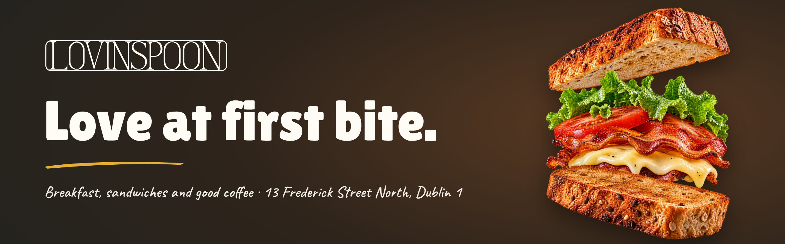
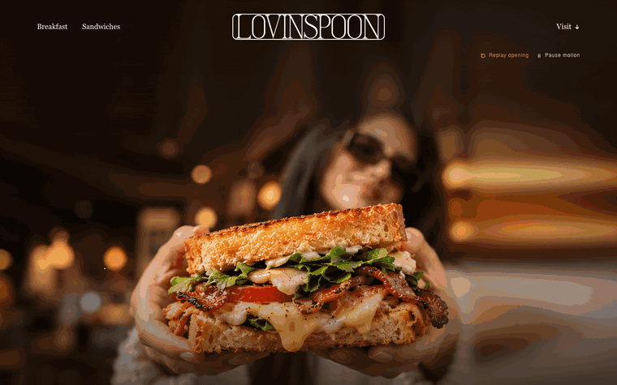
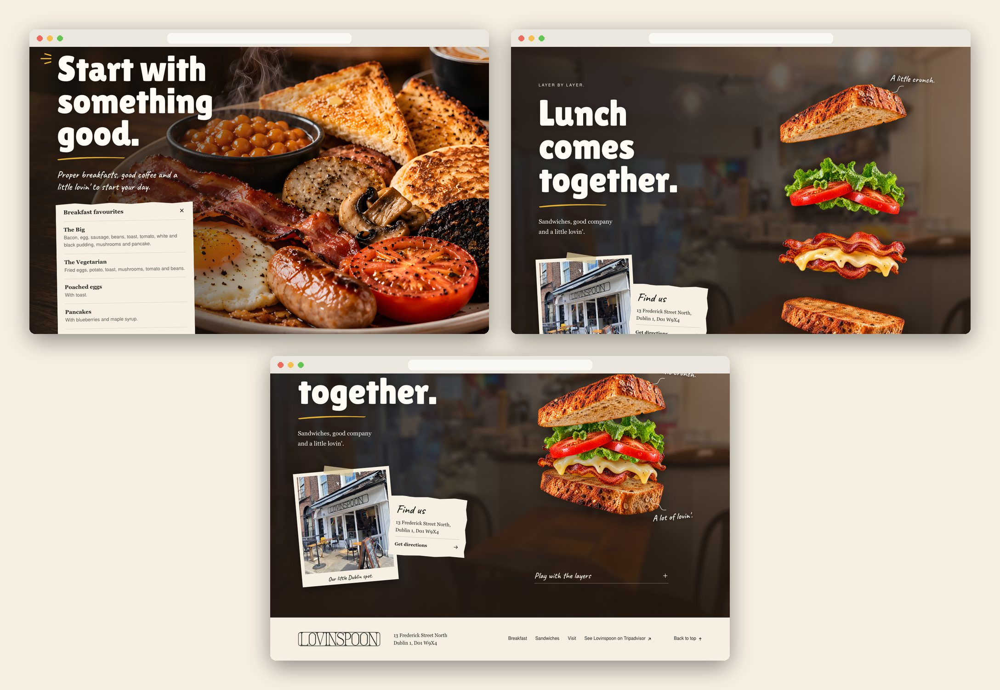
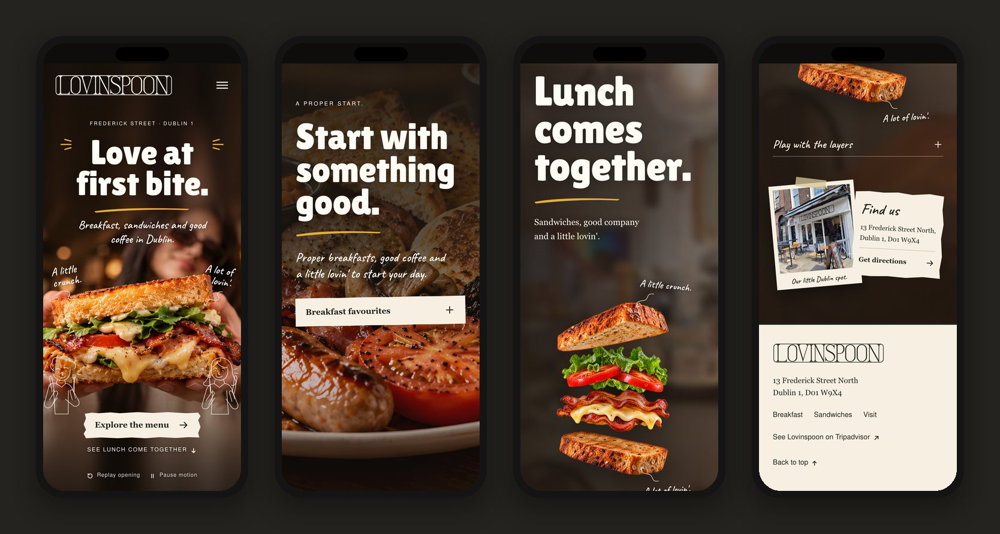

<div align="center">



<h3>A one-page website for a Dublin breakfast and sandwich café, where lunch comes together layer by layer as you scroll.</h3>

<p>
  <a href="https://lovinspoon-dublin.vercel.app"><strong>🌐 Live site</strong></a>
  &nbsp;·&nbsp;
  <a href="#hero-animation"><strong>🎬 How the hero works</strong></a>
  &nbsp;·&nbsp;
  <a href="#getting-started"><strong>🛠️ Run it locally</strong></a>
</p>

<p>
  <a href="https://lovinspoon-dublin.vercel.app"></a>
  
  
  
</p>

</div>

<br />

## 🚀 Overview

**Lovinspoon** is a café at 13 Frederick Street North, Dublin 1, for breakfast, sandwiches and good coffee. This site tells that story in three warm, photographic scenes: a sandwich held out to you with **Love at first bite.**, a full Irish breakfast with **Start with something good.**, and a closing scene where the lunch sandwich **comes together layer by layer** as you scroll, next to a postcard of the real shopfront and the way to get there.

The look comes from the shop itself: the thin serif sign in its long frame, charcoal and ivory from the façade, wood from the tables, and a small mustard accent. Two hand-drawn diners, handwritten notes and torn-paper labels keep it friendly.

- **A scene, not a slideshow**: three full-bleed sections, each with one dominant image and live HTML type on top
- **Lunch you can play with**: the sandwich assembles from four real cut-outs as you scroll, or by hand with a slider and two buttons
- **Built for every visitor**: no scroll lock or pinning, replay and pause controls, a static scene with reduced motion, everything readable without JavaScript
- **Light**: about 290 KB on a phone at first load and 690 KB on a retina desktop; the page itself is 19 KB of HTML, CSS and JS gzipped

<br />

<a name="hero-animation"></a>

## 🎬 The hero animation

<div align="center">
  <a href="https://lovinspoon-dublin.vercel.app"></a>
  <sub>Opening plays once on load · the sandwich follows the scroll · captured at 1440 × 900</sub>
</div>

<br />

The page follows the kit's motion script: a short opening on load, then one scroll-driven gesture at the end of the page.

| When              | What happens                                                                                       |
| :---------------- | :------------------------------------------------------------------------------------------------- |
| 0.00–0.90 s       | The sandwich photo settles from 102.5 % to 100 %                                                   |
| 0.20–1.30 s       | Eyebrow, **Love at first bite.** and the caption rise 16 px into place; the mustard swish sweeps in |
| 0.35–1.65 s       | The two diners draw themselves line by line (`stroke-dashoffset`)                                  |
| 0.65–1.65 s       | *A little crunch.* and *A lot of lovin'.* fade in and their arrows are drawn; mustard sparks flick  |
| Scroll, 0 %       | **Lunch comes together.**: four parts float apart (top bread, lettuce and tomato, bacon and cheese, bottom bread) |
| Scroll, 0 → 100 % | From the moment the figure enters the screen until its middle reaches the middle of the screen, the parts close in from the top down |
| 100 %             | The sandwich sits assembled, the notes riding on the top and bottom bread                          |

**Under the hood**

- 🧩 **Four transparent cut-outs, measured.** Each part was positioned by **image registration** against the kit's assembled still (masked template matching over a scale sweep), so relative sizes are exact. Both states, *open* and *together*, are computed once into `src/data/layers.json` and rendered into the HTML at build time.
- 🎚️ **One progress value, three inputs.** Scroll, the slider and the *Open the layers* / *Bring it together* buttons all drive the same 0–1 value; *Follow scroll* hands control back. Each part has its own small delay and straightens a slight tilt as it lands.
- 🖼️ **A hero re-framed, not cropped.** The campaign still had the sandwich at 70 % of its width. `scripts/compose-hero.py` widens the frame with defocus extensions (edge pixels stretched and blurred hard) so the sandwich sits centred under the title on desktop, and builds a separate portrait plate for phones. Both start from a Real-ESRGAN ×2 upscale.
- 🐢 **Graceful by default.** No pinning and no scroll lock; *Pause motion* freezes the opening and the scroll link; with `prefers-reduced-motion` the opening is skipped and the layers stay open; without JavaScript the full content, address and open layers are still there.

<br />

## 🖥️ Sections

<div align="center">
  
</div>

<br />

| #   | Section                          | Anchor        | Role                                                                                         |
| :-- | :------------------------------- | :------------ | :------------------------------------------------------------------------------------------- |
| 01  | **Love at first bite.**          | `#home`       | First impression: the sandwich, two diners, handwritten notes, **Explore the menu**          |
| 02  | **Start with something good.**   | `#breakfast`  | Full Irish breakfast photo with a torn-paper **Breakfast favourites** list (`<details>`)     |
| 03  | **Lunch comes together.**        | `#sandwiches` | The layered sandwich assembles on scroll, with a *Play with the layers* panel               |
| 03b | Postcard + **Find us**           | `#visit`      | The real shopfront as a taped postcard, the address and **Get directions** (Google Maps)     |
| 04  | Footer                           | n/a           | Logo, address, links and **See Lovinspoon on Tripadvisor**                                   |

<br />

## 📱 Mobile first, motion optional

<div align="center">
  
</div>

<br />

- A portrait hero plate for phones and portrait tablets, so the sandwich stays whole under the title
- Lunch reads title → sandwich → postcard, as the section script asks; no extra section for the shopfront
- Every touch target is at least 44 px; no horizontal scroll from 320 px up
- No parallax on phones; nothing depends on hover

<br />

## ✨ Highlights

- **🎞️ Scroll storytelling without pinning**: the assembly is computed from the figure's own position, so it always plays while the sandwich is on screen
- **🎛️ Motion controls**: *Replay opening*, *Pause motion*, a labelled slider (`aria-valuetext`) and pressed states on the layer buttons
- **🧾 Honest content**: only what the brief confirms (address, Eircode, dishes from the supplied board, Tripadvisor); no prices, hours, phone, bookings or allergen claims
- **✍️ The real sign, in vector**: the kit's logo PNG traced to a 15 KB SVG `<symbol>`, used in chalk on photos and charcoal on paper
- **🖼️ Image pipeline**: Real-ESRGAN ×2, re-framed hero plates, registered layers, then AVIF + WebP at fixed widths with versioned, immutable file names
- **🧪 95 automated checks**: `npm run qa` covers ten viewports, real clicks, a natural wheel scroll, no-JS, reduced motion, keyboard focus, page weight and a scan for production notes in copy and alt text
- **🔎 Ready to share**: Open Graph image, structured data (`CafeOrCoffeeShop`), canonical URL and favicons drawn from the logo's own *L*

<br />

## 💻 Tech stack

| <br />Vite 6 | <br />JavaScript | <br />HTML5 | <br />CSS3 | <br />Python | <br />OpenCV | <br />Playwright | <br />Vercel |
| :---: | :---: | :---: | :---: | :---: | :---: | :---: | :---: |

### Why this stack?

- **Vite + plain JavaScript**: one static page with a 4 KB module; a small Vite plugin (`src/html.js`) writes the pictures, the logo symbol and the layer geometry into the HTML at build time
- **CSS animations for the opening**: one short, seekable timeline with no runtime library
- **Python + OpenCV + Real-ESRGAN** for the image work that has to be measured: upscaling, re-framing, layer registration, logo tracing
- **sharp** for AVIF/WebP derivatives, **Playwright** with the installed Chrome for QA and the README captures
- **Vercel**: every push to `main` deploys automatically

<br />

## 🎨 Design system

| Token    | Value                                                                        | Use                                                   |
| :------- | :--------------------------------------------------------------------------- | :---------------------------------------------------- |
| Charcoal |  | Page background, logo on paper, text on paper (13.9:1) |
| Paper    |  | Buttons, menu list, postcard, address, footer         |
| Chalk    |  | Titles, notes and diners on photos (15.3:1 on charcoal) |
| Mustard  |  | Swish underlines, sparks, focus ring, slider          |
| Wood     |  | Hover on paper (5.5:1 on paper)                       |

- **Type**: Lilita One for titles (72–150 px desktop, 56–96 px phone), Caveat for handwritten notes, Nimbus Sans for the interface, Georgia for buttons and the address; all self-hosted, subset to WOFF2 (83 KB together)
- **Layout**: full-bleed photo sections, a 6 vw gutter (20–88 px), 1,600 px max width for the lunch grid
- **Shapes**: torn-paper `clip-path` on buttons and labels, a taped postcard, no cards or catalogue grids
- **Motion**: 16 px rises over 0.8–0.9 s on load, 0.65 s eased jumps for the layer buttons, nothing loops

<br />

<a name="getting-started"></a>

## 🛠️ Getting started

```bash
# Clone the repository
git clone https://github.com/Jeanfr1/lovinspoon-dublin-website.git
cd lovinspoon-dublin-website

# Install dependencies (Node 20.10+)
npm install

# Start the dev server  →  http://localhost:5173
npm run dev

# Production build  →  dist/
npm run build

# Preview the production build  →  http://localhost:4193
npm run preview

# Run the 95 checks against the preview (or QA_BASE=<url> npm run qa)
npm run qa
```

The generated images and data are committed, so the steps above are all you need. To rebuild them from the kit (Python from Anaconda, Real-ESRGAN weights in `~/.cache/realesrgan/`):

```bash
npm run upscale   # Real-ESRGAN ×2 of the two campaign photos
npm run hero      # wide + portrait hero plates (defocus extensions)
npm run layers    # register the four cut-outs, write src/data/layers.json
npm run logo      # trace the logo PNG to src/assets/logo.svg
npm run images    # AVIF + WebP derivatives, favicons → public/
npm run fonts     # subset the kit fonts → public/fonts/
```

<br />

## 📁 Project structure

```
lovinspoon-dublin-website/
├── index.html                  # Every section: hero → breakfast → lunch (+ visit postcard) → footer
├── src/
│   ├── main.js                 # Replay/pause, mobile nav, reveal, sandwich progress (scroll, slider, buttons)
│   ├── html.js                 # Vite plugin: <picture> markup, logo <symbol>, layer geometry at build time
│   ├── styles/main.css         # Tokens, sections, opening keyframes, responsive and reduced-motion rules
│   ├── data/                   # layers.json (registered geometry), images.json (generated widths)
│   └── assets/logo.svg         # Traced logo
├── public/                     # img/ (AVIF + WebP), fonts/ (WOFF2 + licences), favicons, og-v1.jpg, robots.txt
├── scripts/                    # upscale, compose-hero, register-layers, trace-logo, build-images, subset-fonts,
│                               # qa, shots, readme-assets, readme-composite
├── 01-identidade … 11-maquetes # The design kit, kept as delivered (excluded from the deploy)
├── LEIA-ME-KIT.md              # The kit's own README (renamed so this one can live at the root)
└── vercel.json                 # Vite preset, dist/, immutable caching, noindex header
```

<br />

## 🚀 Deployment

Hosted on **Vercel** and connected to this repository: every push to `main` ships to production.

**Live site:** [lovinspoon-dublin.vercel.app](https://lovinspoon-dublin.vercel.app)

| Setting          | Value           |
| :--------------- | :-------------- |
| Framework        | Vite            |
| Build command    | `npm run build` |
| Output directory | `dist`          |

The site is published with `noindex` (meta tag, `X-Robots-Tag` header and `robots.txt`) until the owner approves it.

<br />

## 📌 Content checklist

Items waiting on the café. Each one is marked `TODO(lovinspoon)` in `index.html`.

- [ ] Owner sign-off on the hero and breakfast photography (campaign images made for the project, anonymous model)
- [ ] Confirm the four breakfast favourites (transcribed from the supplied board, date unknown)
- [ ] Real sandwich names, if wanted; the layered sandwich shows the category, not a named item
- [ ] Official photos, or permission, for the shopfront postcard and the interior background (public web photos, sources in `00-referencias/FONTES-E-DADOS.md`)
- [ ] Official logo master (the current one is traced from the kit's reconstruction of the sign)
- [ ] Opening hours and phone, once confirmed (online sources disagree, so neither is shown)
- [ ] Google place link (`maps.google.com/?cid=…`) to replace the directions search
- [ ] Custom domain, then update `canonical` and `og:url` and remove `noindex`

**Choices made where the brief disagreed with itself**

- **Mobile lunch order**: the section script puts the layers under the title and the postcard at the base; the mobile mock-up and the study had the postcard first. The script was followed.
- **Copy**: where the concept board and the copy file differ (breakfast line, lunch line, layer notes), the copy file was used; the board's *Toasted bread / Crispy bacon / Fresh ingredients* labels were left out because they describe a recipe the café hasn't confirmed.
- **Hero framing**: the board centres the sandwich; the kit's still has it off-centre. The still was widened instead of cropped, so the board's composition holds without changing the photo.
- **Alt texts**: the kit's suggested alt texts described how the images were made; they were rewritten to describe what the images show.

<br />

## 🙏 Acknowledgments

- **Lovinspoon** for the café, the menu board and the approved direction
- **[Lilita One](https://fonts.google.com/specimen/Lilita+One)** by Juan Montoreano and **[Caveat](https://fonts.google.com/specimen/Caveat)** by Impallari Type (OFL)
- **[Nimbus Sans](https://github.com/ArtifexSoftware/urw-base35-fonts)** by URW (AGPL-3 with font exception)
- **[Real-ESRGAN](https://github.com/xinntao/Real-ESRGAN)** (BSD-3), **[OpenCV](https://github.com/opencv/opencv)** and **[sharp](https://sharp.pixelplumbing.com)** for the image pipeline
- **[Vite](https://vite.dev)**, **[Playwright](https://playwright.dev)** and **[Vercel](https://vercel.com)**

<br />

---

<div align="center">
  
  <p><strong>Love at first bite.</strong></p>
  <p>Built with ❤️ by <a href="https://github.com/Jeanfr1">Jean</a> for Lovinspoon</p>
  <sub>© 2026 Lovinspoon. All rights reserved.</sub>
</div>
